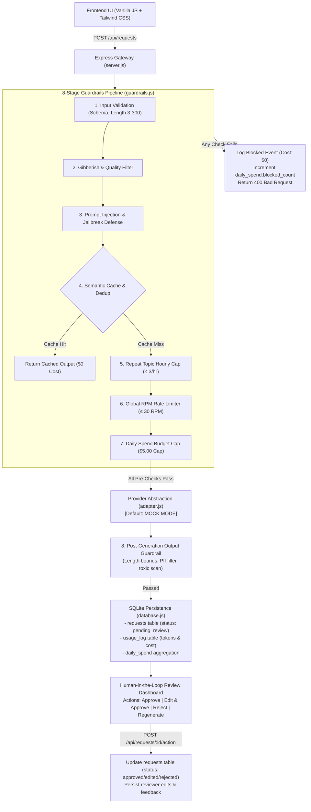

# Tekion AI Content Generation MVP · Guardrails & HITL Governance

A modular, production-ready Node.js/Express MVP application implementing an 8-stage deterministic guardrail pipeline, zero-spend **MOCK mode** adapter, SQLite telemetry logging, and a Human-in-the-Loop (HITL) review dashboard.

---

## Architecture & System Overview



---

## File Tree

```
c:\Users\Personal\.gemini\antigravity\scratch\Tekion_PM2\
├── .env                  # Runtime configuration (PORT, MOCK_MODE, caps)
├── .env.example          # Template configuration
├── package.json          # Node dependencies & npm scripts
├── server.js             # Express API gateway & endpoints
├── database.js           # SQLite3 initialization, promisified helpers & schema
├── guardrails.js         # Sequential 8-stage guardrails engine
├── adapter.js            # Provider abstraction with realistic mock synthesis
├── sample_runner.js      # CLI demo script executing 3 distinct topic blueprints
├── data/
│   └── app.db            # SQLite database file (WAL mode)
├── public/
│   └── index.html        # Single-page web dashboard with Tailwind CSS
└── README.md             # Architecture documentation & guide
```

---

## Tech Stack

- **Backend**: Node.js (v18+), Express.js (v4), SQLite3 (v5), UUID (v11), Dotenv, CORS.
- **Frontend**: Single-page application served from `public/index.html`, Vanilla JavaScript, Tailwind CSS via CDN.
- **Database**: SQLite3 (single local file `data/app.db`) with Write-Ahead Logging (WAL) enabled for concurrency.

---

## The 8 Guardrails Explained

| Step | Guardrail | Type | Description | Failure Response |
| :--- | :--- | :--- | :--- | :--- |
| **1** | **Input Validation** | Pre-gen | Verifies `topic` presence, length bounds (3–300 chars), enum validation for `generation_option` and `style`. | 400 Bad Request |
| **2** | **Gibberish Filter** | Pre-gen | Detects repeated character spam (`aaaaa`), keyboard mash (`asdfgh`, `qwerty`), and phonetic consonant clustering with low vowel ratios (< 15%). | 400 Bad Request |
| **3** | **Prompt Injection** | Pre-gen | Heuristic & regex inspection blocking instructions overrides (`ignore previous instructions`), DAN mode, system prompt leakage, and script injection. | 400 Bad Request |
| **4** | **Dedup / Semantic Cache** | Pre-gen | Checks if an identical normalized topic was generated & approved within the last 24 hours. Returns cached result instantly with **$0 token cost**. | 200 OK (Cache Hit) |
| **5** | **Repeat Topic Cap** | Pre-gen | Restricts querying identical topics to max 3 times per hour, preventing retry loops or runaway loops. | 400 Bad Request |
| **6** | **Global Rate Limit** | Pre-gen | Sliding-window throughput safeguard limiting requests across the entire system to max 30 RPM. | 400 Bad Request |
| **7** | **Daily Spend Cap** | Pre-gen | Assesses accumulated daily spend against `DAILY_SPEND_CAP_USD` ($5.00 limit). Halts generation if budget is depleted. | 400 Bad Request |
| **8** | **Output Safety Check** | Post-gen | Validates output length (> 50 chars), scans for leaked PII patterns (SSN, credit card formats), confidential markers, and checks image URI validity. | 422 Unprocessable |

---

## Database Schema (`data/app.db`)

### 1. `requests`
Records all incoming requests, execution lifecycle, generated outputs, reviewer changes, and final status:
- `id` (TEXT PRIMARY KEY) - UUIDv4
- `topic` (TEXT NOT NULL) - User input topic prompt
- `generation_option` (TEXT NOT NULL) - `text`, `text_image`, `image_only`
- `style` (TEXT NOT NULL) - `article`, `guide`, `opinion`, `trend_analysis`
- `status` (TEXT NOT NULL) - `pending_review`, `approved`, `edited`, `rejected`, `guardrail_blocked`
- `guardrail_step` (TEXT) - Step where check resolved or blocked
- `blocked_reason` (TEXT) - Explanatory message when blocked
- `generated_text` (TEXT) - Original model generation
- `generated_image_url` (TEXT) - Synthetic image data URI
- `final_text` (TEXT) - Reviewer-modified text upon approval
- `cost` (REAL) - Estimated USD cost
- `is_cached` (INTEGER) - 1 if served from dedup cache, 0 otherwise
- `review_feedback` (TEXT) - Editorial notes by reviewer
- `created_at`, `updated_at` (DATETIME)

### 2. `usage_log`
Granular per-request token and cost tracking:
- `id` (INTEGER PRIMARY KEY AUTOINCREMENT)
- `request_id` (TEXT) - Foreign key referencing `requests.id`
- `provider` (TEXT) - e.g. `mock-provider`
- `model` (TEXT) - e.g. `mock-text-curie-v2`
- `prompt_tokens`, `completion_tokens`, `total_tokens` (INTEGER)
- `image_count` (INTEGER)
- `cost` (REAL) - Itemized cost in USD
- `timestamp` (DATETIME)

### 3. `daily_spend`
Daily aggregated spend ledger for budget enforcement:
- `date` (TEXT PRIMARY KEY) - `YYYY-MM-DD`
- `total_spend` (REAL) - Running USD spend for the day
- `request_count` (INTEGER) - Total requests received
- `blocked_count` (INTEGER) - Requests prevented by guardrails
- `tokens_used` (INTEGER) - Cumulative token count

---

## API Reference

### 1. Submit Request
`POST /api/requests`
```json
{
  "topic": "Autonomous Commercial Fleet Telematics",
  "generationOption": "text_image",
  "style": "article"
}
```
**Response (201 Created)**:
```json
{
  "success": true,
  "requestId": "9021c0b2-...",
  "isCached": false,
  "data": { ... },
  "usage": { "promptTokens": 95, "completionTokens": 262, "totalTokens": 357, "cost": 0.02064 },
  "stepsEvaluated": [ ... ]
}
```

### 2. Get Request by ID (Status Polling)
`GET /api/requests/:id`

### 3. List Recent Requests
`GET /api/requests`

### 4. Human-in-the-Loop Action
`POST /api/requests/:id/action`
```json
{
  "action": "edit",
  "editedText": "# Updated Title\nCustom content verified by human reviewer.",
  "reviewFeedback": "Adjusted formatting and confirmed domain accuracy."
}
```
*Supported actions: `approve`, `edit`, `reject`, `regenerate`.*

### 5. Telemetry & Budget Stats
`GET /api/stats`

### 6. Sample Batch Demo (3 Distinct Topics)
`POST /api/mock/sample-batch`

---

## Getting Started

### Prerequisites
- Node.js (v18 or higher recommended)
- npm (v9+)

### Installation
```bash
# Clone or enter project root
cd Tekion_PM2

# Install dependencies (express, sqlite3, uuid, dotenv, cors)
npm install
```

### Running the Application

1. **Start the Web Server**:
   ```bash
   npm start
   ```
   Open your browser at **[http://localhost:3000](http://localhost:3000)**.

2. **Run Sample Generation Script (3 Distinct Topics)**:
   ```bash
   npm run sample
   ```
   This executes 3 production-grade blueprints (`Next-Generation Solid-State EV Battery Chemistries`, `AI-Powered Customer Retention Strategies for Auto Dealerships`, and `Autonomous Commercial Fleet Telematics & Predictive Maintenance`) directly through the 8-stage pipeline and prints formatted telemetry.

3. **Development Mode (Auto-reload)**:
   ```bash
   npm run dev
   ```

---
5. **Reset Spend**: Resets today's spend counter to test daily spend thresholds.
